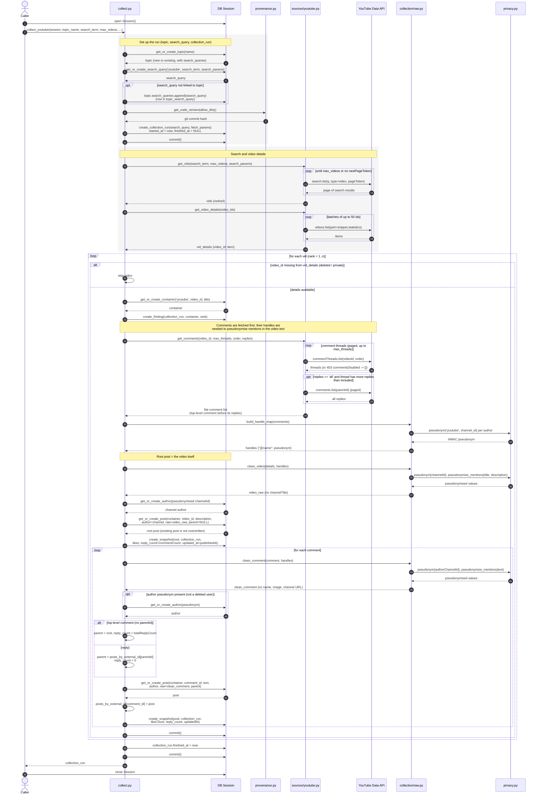

# Collection: sequence diagram

This diagram shows how `collect_youtube()` in `src/radar/collection/collect.py` fills **Block 1: Collection** of the [data model](data-model.md). It covers one call: one topic, one search term, one collection run.

Participants:

| Participant | Module | Role |
|---|---|---|
| `collect` | `radar.collection.collect` | Orchestrates the run, commits it step by step |
| `DB` | session of the caller + `radar.db.models.collection` | SQLAlchemy session and ORM tables |
| `provenance` | `radar.provenance` | Git commit as `code_version` |
| `youtube` | `radar.sources.youtube` | Wraps the YouTube Data API v3 (paging, batching) |
| `API` | YouTube Data API v3 | External service |
| `raw` | `radar.collection.raw` | Strips personal data from raw API items |
| `privacy` | `radar.privacy` | HMAC pseudonyms, replaces @-mentions |

## Notes

- **Session.** The caller (the CLI, a test) opens the session and passes it in; `collect_youtube` never opens one itself, so it can run against any database. It commits itself, because a run is stored step by step.
- **Commit points.** The run is committed before any API call, and then once per video. If the process aborts, the videos stored so far are kept and `collection_run.finished_at` stays `NULL`, which the data model defines as "aborted or running".
- **Append, don't overwrite.** `topic`, `search_query`, `container`, `author` and `post` are *get-or-create*. A post that already exists from an earlier run keeps its text and `raw` ("first fetch only"). Only `finding` and `snapshot` are always created new, so every run records its own ranks, likes, reply counts and edit times.
- **Reply tree.** The YouTube API only references the top-level comment of a reply, so every reply gets that comment as its parent. Because `get_comments` returns a top-level comment before its replies, the parent is already in `posts_by_external_id` when a reply is processed.
- **Pseudonymisation happens before storage.** Author IDs (channels and commenters) are replaced by HMAC pseudonyms, and @-mentions of known handles in titles, descriptions and comment texts are replaced as well. Only cleaned copies reach `post.raw` and `author.pseudonym`.
