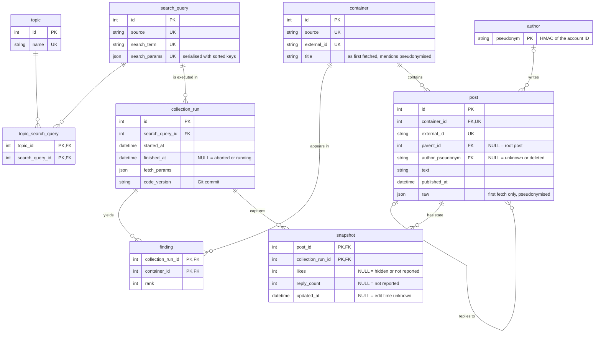
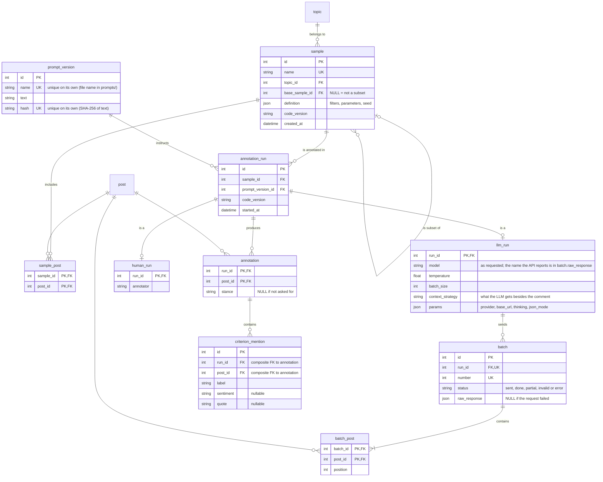
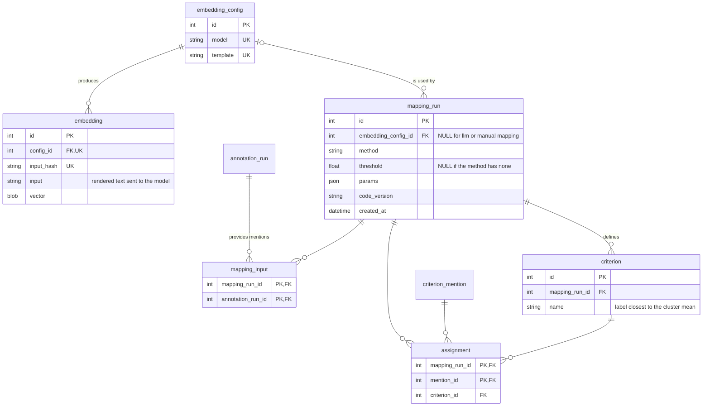

# Data model

The database is split into three blocks that follow the pipeline stages. Each block is implemented in its own module under `src/radar/db/models/`.

Notation: `||--o{` means "exactly one to zero or more". Several `UK` markers in one table form **one** composite unique key, unless a column is noted as unique on its own.

## Block 1: Collection (`collection.py`)

A **search query** describes *what* is searched; a **collection run** describes *when* it was executed and how deeply comments were fetched. Running the same query again appends data instead of overwriting it. A **finding** records which run found which container (video or thread) at which rank. A **container** holds **posts** as a tree: every container has exactly one root post (the video with its description, or the thread post), and comments point to their parent. Values that change between fetches (likes, reply count, last edit) live in **snapshots**.

## Block 2: Sampling and annotation (`annotation.py`)

A **sample** is a frozen set of posts for one topic; its `definition` records the filters (and seed) that produced it, so it can be reproduced. Samples can be subsets of other samples. An **annotation run** extracts criteria from a sample with one **prompt version**, either by an LLM or by a human; both share the same structure, so runs and annotators are compared the same way. **Batches** record what was sent to the LLM, **annotations** what came back, so skipped posts can be detected and resent. A post without criteria still gets an (empty) annotation.

## Block 3: Mapping (`mapping.py`)

Criterion labels from different runs name the same thing differently ("CO2", "climate protection"). An **embedding config** defines the model and a template for the text that is embedded (first version: topic prefix plus label; later possibly plus the quote). **Embeddings** are cached by the hash of that text. A **mapping run** clusters the embeddings of the mentions from its input runs; each cluster becomes a **criterion**, outliers become criteria of their own. **Assignments** link every mention to its criterion. Criteria belong to a mapping run, so different thresholds or methods yield comparable but separate vocabularies.

## From mentions to weights

Salience weights are not stored; they are computed as SQL views along the chain post → annotation → criterion mention → assignment (for one mapping run) → criterion, e.g. distinct authors per criterion and month.

## Computed, not stored

Everything that follows from stored data is computed on request, so it cannot disagree with the data and needs no table or column:

- **Quote fidelity** of a run (`radar.analysis.quotes`, `radar quotes`): the share of `criterion_mention.quote` values that occur word for word in `post.text` of their post.
- **Root post or comment**: `post.parent_id IS NULL` marks the root post; a reply is a post whose parent has a parent itself.
- **Kind of a run**: an annotation run is an LLM run or a human run by the subtype row it has.
