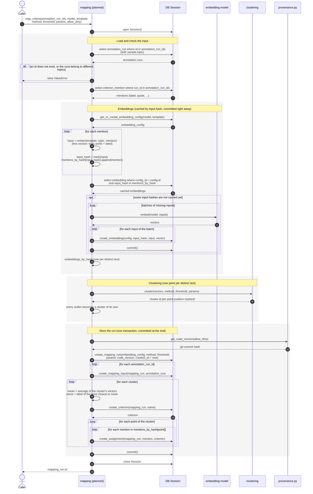

# Mapping: sequence diagram (planned)

This diagram describes the **planned** mapping function, `map_criteria()`, which fills **Block 3: Mapping** of the [data model](data-model.md). It follows the style of `collect_youtube()` (see [collection-sequence.md](collection-sequence.md)): one session, small *get-or-create* / *create* helpers, explicit parameters, and `code_version` from `provenance`.

Design decisions behind the diagram:

- **Input:** the caller lists the annotation runs explicitly (`annotation_run_ids=[3, 7]`). Each one becomes a `mapping_input` row.
- **Clustering:** the method is kept generic: `cluster(vectors, method, threshold, params)`. Points that fit no cluster (outliers) become a criterion of their own.
- **Points:** one point per distinct embedded text, not per mention. If "CO2" was extracted 50 times, it is one point, and all 50 mentions are assigned to that point's criterion afterwards.
- **Transactions:** new embeddings are committed as soon as they are computed, so the cache survives a crash. `mapping_run`, `mapping_input`, `criterion` and `assignment` are committed together at the end, so a stored mapping run is always complete.

Participants:

| Participant | Module | Role |
|---|---|---|
| `map` | `radar.mapping` (planned) | Orchestrates the mapping, owns the DB session |
| `DB` | `radar.db.engine.Session` + `radar.db.models` | SQLAlchemy session and ORM tables (blocks 2 and 3) |
| `embedder` | `radar.sources` (embedding model) | Turns texts into vectors |
| `cluster` | clustering helper (generic) | Groups vectors and marks outliers |
| `provenance` | `radar.provenance` | Git commit as `code_version` |

## Notes

- **Each mention gets exactly one assignment.** Every mention has one input hash, every hash is one point, and every point (outliers included) belongs to exactly one cluster. So `assignment` covers all mentions of the input runs, and the weight views can rely on that.
- **Embeddings are reused across runs.** A second mapping run with the same model and template, but a different method or threshold, does not call the embedding model again. Only `criterion` and `assignment` are new, so the vocabularies are separate but comparable.
- **One topic per run.** The topic prefix in the template has to be the same for all inputs, so the function rejects annotation runs from different topics. This was my assumption; drop the check if cross-topic mapping is wanted.
- **Criterion names.** A criterion is named after the label of the point closest to the cluster mean. As long as the template is "topic prefix + label", one point equals one distinct label. If the quote is added to the template later, several points can share a label, and the name is still taken from the closest point.
- **Return value.** Unlike `collect_youtube()`, the function returns the new `mapping_run.id`, because the weight views are always queried for one mapping run.
- **Out of scope.** LLM-based or manual mapping (`mapping_run.embedding_config_id = NULL`) would skip the embedding and clustering steps. That flow is not shown here.
